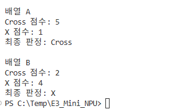

# Mission E3 — STEP 1~9, README 및 GitHub 업로드 전체 대화 기록(재구성본)

> **기록 방식 안내**: 이 문서는 현재 대화에서 확인할 수 있는 사용자 발화·실행 결과와 기존 수행결과보고서를 바탕으로 **시간순으로 재구성한 대화 기록**입니다. 일부 과거 답변은 현재 제공된 대화 맥락에서 전문이 생략되어 있으므로 **원문 그대로의 완전한 채팅 내보내기 파일은 아닙니다**. 그런 구간은 `[안내 내용 재구성]`으로 표시했습니다. 실제 명령과 결과는 확인된 범위에서만 기록했습니다. 원문 그대로의 모든 메시지가 필요하면 ChatGPT 데이터 내보내기 원본이 필요합니다.

- 과제: Mini NPU Simulator (Mission E3)
- 운영 환경: **Windows + VS Code + PowerShell + Python**, Ubuntu/WSL 사용하지 않음
- 프로젝트 폴더: `C:\Temp\E3_Mini_NPU`
- GitHub: <https://github.com/bigpark61/MAC_Calc>
- 최종 확인된 테스트: 자동 통합 **9 PASS / 0 FAIL**; JSON 패턴 정답 비교 **3 PASS / 3 FAIL**
- 이미지: `images/` 폴더에 대화 중 공유된 실제 캡처 파일을 보존함

## 대화 전체 흐름

| 순서 | 사용자 요청 / 검증 | 어시스턴트 안내 및 결과 |
|---|---|---|
| STEP 1 | Windows VS Code 환경으로 개발 | 개발환경, 폴더, Python 실행 확인 |
| STEP 2 | 배열·필터와 입출력 설계 | A/B/F 구조, MAC 및 판정 설계 |
| STEP 3 | 3×3 배열 입력·출력·검증 | 2차원 리스트 구현 |
| STEP 4 | MAC 연산 구현 | 원소별 곱셈과 누산 |
| STEP 5 | epsilon 판정 | Cross/X/UNDECIDED |
| STEP 6 | 메뉴 통합 | 1 사용자 입력, 2 JSON, 0 종료 |
| STEP 7 | JSON 분석 | 6패턴 검사, 원래 알고리즘에서 3 PASS/3 FAIL |
| STEP 8 | 성능 측정 | 3, 5, 13, 25 크기, O(N²) |
| STEP 9 | 예외·회귀·통합 테스트 | 크기 검증 5/5, 최종 9/9 |
| 제출 | README, GitHub | 파일 점검, git 초기화, 원격 연결, 충돌 해결 |


## STEP 1. 환경 확인 및 프로젝트 준비

**사용자:** “Mission E3의 STEP 1부터 시작하겠습니다. WSL Ubuntu 환경에서 …” 이후 “Windows 와 vs-code 만 사용할거야. Ubuntu 는 사용하지 않는다”라고 실행 환경을 확정.

**어시스턴트 [안내 내용 재구성]:** Windows에서 VS Code를 열고 PowerShell 터미널을 사용하여 Python 설치와 프로젝트 경로를 확인. Ubuntu/WSL 관련 지시는 적용하지 않음.

```powershell
cd C:\Temp\E3_Mini_NPU
python --version
```

**검증:** 이후 모든 실행 화면의 프롬프트가 `PS C:\Temp\E3_Mini_NPU>`로 표시되어 Windows PowerShell 환경에서 수행했음이 확인됨.

## STEP 2. 입력·출력 및 알고리즘 설계

**어시스턴트 [안내 내용 재구성]:** 2차원 배열 A/B와 필터 F를 Python 중첩 리스트로 표현. 같은 위치의 값을 곱한 뒤 합산하는 MAC 연산을 구현하고, 두 필터 점수를 비교하는 판정 구조를 설계. JSON 분석은 크기별 Cross/X 필터와 패턴 데이터를 대상으로 함.

> STEP 1~2의 독립적인 전체 채팅 답변이나 실행 캡처는 현재 확인되지 않아 요약으로 기록함.

## STEP 3. 3×3 배열 구현

**사용자:** “3. STEP 3. 2차원 배열 구현 — 3×3 배열 입력, 출력, 검증. 3단계를 먼저 구현하자.”

**어시스턴트 [안내 내용 재구성]:** 각 행에서 정수 3개를 입력받아 3행의 리스트로 저장하고 화면에 다시 출력. 숫자 개수·형식 검증을 추가.

```python
A = [[1, 0, 1], [0, 1, 0], [1, 0, 1]]
B = [[0, 1, 0], [1, 1, 1], [0, 1, 0]]
for row in A:
    print(*row)
```

**검증:** 사용자 입력 모드에서 A/B/F 배열을 3×3으로 출력한 화면이 이후 확인됨.

## STEP 4. MAC 연산 구현

**사용자:** “실행 결과가 정상이라면 다음 STEP 4에서 이 배열을 그대로 사용하여 MAC(원소별 곱셈 및 누산) 연산을 구현하겠습니다.”

**어시스턴트 [안내 내용 재구성]:** 각 좌표의 배열 값과 필터 값을 곱하여 누산.

```python
def mac(matrix, filter_matrix):
    total = 0
    for i in range(len(matrix)):
        for j in range(len(matrix[i])):
            total += matrix[i][j] * filter_matrix[i][j]
    return total
```

> 위 코드는 연산 원리를 설명하는 축약 예시이며, 최종 코드에는 별도의 크기 검증이 추가됨.

## STEP 5. Cross/X와 epsilon 판정

**사용자:** “STEP 5에서는 십자가 필터와 X 필터의 MAC 점수를 비교하고, 점수 차이가 `epsilon` 이하이면 `UNDECIDED`로 판정하는 기능을 구현하겠습니다.”

**사용자 실행 결과:** 배열 A는 Cross 5 / X 1 → Cross, 배열 B는 Cross 2 / X 4 → X.

**어시스턴트 [안내 내용 재구성]:** `abs(cross_score - x_score) <= epsilon`이면 `UNDECIDED`, 그렇지 않으면 점수가 높은 필터로 분류.

```python
if abs(cross_score - x_score) <= epsilon:
    result = 'UNDECIDED'
elif cross_score > x_score:
    result = 'Cross'
else:
    result = 'X'
```

## STEP 6. 사용자 입력 메뉴 통합

**사용자:** “STEP 6에서는 지금까지 만든 기능을 메뉴 방식으로 통합하여 사용자가 `1. 사용자 입력 모드`를 선택하면 배열을 입력하고 MAC 점수 및 판정 결과를 확인하도록 구현.”

**사용자 실행 결과:** A와 B, 필터 F를 직접 입력하고 A 점수 5, B 점수 1, 판정 A를 확인. 다른 테스트에서는 A 점수 1, B 점수 5, 판정 B를 확인하고 메뉴로 정상 복귀함.

```text
=== Mini NPU Simulator ===
[모드 선택]
1. 사용자 입력 (3x3)
2. data.json 분석
0. 종료
```

## STEP 7. data.json 분석 모드

**사용자:** “Mission E3 STEP 7을 시작하겠습니다. Windows + VS Code 환경에서 기존 main.py를 유지하면서 data.json 분석 모드를 순차적으로 구현해 주세요. 먼저 data.json 구조 확인부터 안내하고 각 단계의 실행 결과를 검증하겠습니다.”

**7-1 JSON 구조 확인:** `check_json.py`로 최상위 키 `meta`, `filters`, `patterns` 확인. 필터는 `size_5`, `size_13`, `size_25` 아래 각각 `cross`, `x`. 패턴 키는 `size_5_1`, `size_5_2`, `size_13_1`, `size_13_2`, `size_25_1`, `size_25_2`.

**7-2 메뉴 2 JSON 로딩:** `data.json 로드 성공`, 필터 크기 3종, 패턴 6개 출력 확인.

**7-3 패턴/필터 추출:** 크기 5×5, 13×13, 25×25와 예상 판정 x 또는 +, 입력 배열 및 필터 검증 `True` 확인.

**7-4 MAC 점수 및 판정:** 일부 경계 패턴에서 Cross와 X 점수가 거의 같아 `UNDECIDED`로 판정됨. 예: Cross `0.9`, X `0.8999999999999999`.

**7-5 판정 검증:** 정규화된 MAC 비교 방안도 검토하였으나 최종 과제는 **원래 MAC과 epsilon 판정**을 유지하기로 선택함. 이에 따라 다음 결과를 확정함.

```text
=== 전체 테스트 결과 요약 ===
총 테스트: 6
PASS: 3
FAIL: 3

[실패 케이스]
size_5_1: 예상=x, 실제=UNDECIDED
size_13_2: 예상=Cross, 실제=UNDECIDED
size_25_1: 예상=X, 실제=UNDECIDED
```

**의미:** JSON 정답과 알고리즘 출력의 불일치이지, Python 프로그램 실행 오류가 아님.

## STEP 8. MAC 성능 측정

**사용자:** “Mission E3 STEP 7을 완료했습니다. 원래 MAC 연산과 epsilon 판정 결과 총 6건 중 PASS 3건, FAIL 3건을 확인했습니다. Windows + VS Code 환경에서 기존 main.py를 유지하면서 STEP 8 성능 측정 기능을 단계별로 구현해 주세요.”

**어시스턴트 [안내 내용 재구성]:** `time.perf_counter()`를 이용해 배열 크기별 평균 실행시간 측정. 연산 횟수는 원소 개수 N².

| 배열 크기 | MAC 연산 횟수 |
|---|---:|
| 3×3 | 9 |
| 5×5 | 25 |
| 13×13 | 169 |
| 25×25 | 625 |

**사용자 확인:** 성능 표와 `시간복잡도: O(N^2)` 출력. 시간은 실행마다 변동되며, 크기 검증을 포함한 측정은 순수 MAC 시간과 구분할 필요가 있음.

## STEP 9. 예외 처리와 통합 검증

### STEP 9-1. 메뉴 반복 실행 확인

**사용자:** 성능 분석을 마친 후 메뉴가 다시 출력되는 화면을 제공. 프로그램이 분석 후 종료되지 않고 메뉴로 복귀함을 확인.

### STEP 9-2. 사용자 입력 및 메뉴 오류

**사용자:** 메뉴에 `3`, `abc`, 빈 입력, `-1`을 입력했을 때 `[입력 오류] 0, 1, 2 중 하나를 선택하세요.`가 출력되고 다시 메뉴로 복귀하는 것을 확인. `0` 입력 시 `프로그램을 종료합니다.` 출력.

**사용자:** “Mission E3 STEP 9-2 배열 입력 예외 처리 테스트를 모두 완료했습니다.”

### STEP 9-3. JSON 오류 처리

**사용자:** `data.json`을 `data_temp.json`으로 바꾼 뒤 메뉴 2를 실행하여 `오류: data.json 파일을 찾을 수 없습니다.`를 확인. JSON 문법 오류를 주입하여 `JSON 형식 오류: Expecting value: line 1 column 14 (char 13)`를 확인. 필수 키 누락 테스트와 원본 복구까지 완료.

```powershell
Copy-Item .\data.json .\data_backup.json
Rename-Item .\data.json data_temp.json
# 파일 복구
Copy-Item -Path .\data_backup.json -Destination .\data.json -Force
(Get-FileHash .\data.json).Hash -eq (Get-FileHash .\data_backup.json).Hash
```

**검증:** 파일 해시 비교에서 `True`를 확인하여 원본 복구 완료.

### STEP 9-4. 배열 및 필터 크기 불일치

**사용자:** 9-4-1 배열 크기 검증 5/5 PASS. 9-4-2에서 `mac()` 함수에 크기 검증 적용.

```text
=== STEP 9-4-2 MAC 검증 테스트 ===
정상 3x3: MAC 결과=5 → PASS
3x3 vs 5x5: 오류 감지 → PASS
행 개수 부족: 오류 감지 → PASS
열 개수 부족: 오류 감지 → PASS
빈 배열: 오류 감지 → PASS
전체 결과: 5/5 PASS
```

### STEP 9-5. 회귀 및 최종 통합 테스트

**9-5-1 JSON 회귀:** 크기 검증 이후에도 JSON 분석 6건 중 PASS 3 / FAIL 3 및 동일 실패 케이스 유지.

**9-5-2 사용자 입력:** A=1, B=5, 판정 B 및 메뉴 복귀 확인.

**9-5-3 메뉴 오류·종료:** 빈 입력과 -1 입력 시 오류 후 메뉴 복귀, 0 입력 시 정상 종료 확인.

**9-5-4 성능 회귀:** 3×3=9, 5×5=25, 13×13=169, 25×25=625 및 O(N²) 확인.

**9-5-5 최종 자동 테스트:** `test_final.py` 실행.

```powershell
python test_final.py
```

```text
=== Mission E3 최종 통합 테스트 ===
[PASS] 3x3 MAC 연산
[PASS] 정상 배열 크기 검증
[PASS] 크기 불일치 오류 처리
[PASS] Cross 라벨 정규화
[PASS] X 라벨 정규화
[PASS] UNDECIDED 판정
[PASS] JSON 데이터 구조
[PASS] JSON 패턴 6개
[PASS] MAC 성능 측정

=== 최종 통합 테스트 결과 ===
총 테스트: 9
PASS: 9
FAIL: 0
최종 통합 테스트 성공
```

## STEP 9-6. README 작성 및 GitHub 업로드 대화

### 9-6-1 README 작성

**사용자:** “Mission E3 STEP 9-5-5 최종 통합 테스트 9/9 PASS를 확인했습니다. STEP 9-6-1을 시작하여 Windows + VS Code 환경의 프로젝트 개요, 실행 방법, MAC 알고리즘, JSON 분석 결과(PASS 3/FAIL 3), 성능 측정, 최종 통합 테스트(9/9 PASS)를 포함한 GitHub 제출용 README.md를 작성해 주세요.”

**어시스턴트:** README 초안을 생성하고 프로젝트 폴더에 배치, VS Code에서 Markdown 미리보기(`Ctrl+Shift+V`) 확인 안내.

### 9-6-2 제출 파일 및 .gitignore

**사용자:** “진행해줘.”

**어시스턴트:** 제출 파일 확인, `.gitignore` 작성, Git 설치 확인 및 저장소 상태 확인을 안내.

**사용자 실행 결과:** `git version 2.55.0.windows.5`; `git status`와 `git remote -v`는 처음에 `fatal: not a git repository`.

### 9-6-3 로컬 Git 초기화

```powershell
cd C:\Temp\E3_Mini_NPU
git init -b main
git status
git status --short
```

**사용자 실행 결과:** `Initialized empty Git repository in C:/Temp/E3_Mini_NPU/.git/`, `On branch main`, `No commits yet` 및 8개 Untracked 파일.

```text
.gitignore
README.md
check_json.py
data.json
main.py
test_dimension.py
test_final.py
test_mac.py
```

### 9-6-4 원격 저장소 연결

**사용자:** `git remote add origin https://github.com/bigpark61/MAC_Calc.git` 실행.

**어시스턴트:** 원래 제안했던 `E3_Mini_NPU` 저장소가 아니라 실제로 연결된 `MAC_Calc` 저장소를 사용할지 확인. 사용자는 `MAC_Calc`의 `main`에 업로드하기를 선택.

```powershell
git remote -v
git ls-remote --heads origin main
```

**사용자 실행 결과:** `origin https://github.com/bigpark61/MAC_Calc.git` (fetch/push), 원격 `refs/heads/main` 존재 확인.

### 9-6-5 파일 등록과 Commit

```powershell
git add .
git status
git commit -m "Complete Mission E3 Mini NPU Simulator"
```

**사용자 실행 결과:** 8개 파일이 `Changes to be committed`에 등록됨. 이후 `git commit` 재실행 시 `nothing to commit, working tree clean` 출력으로 이미 로컬 Commit이 생성된 상태임을 확인. README의 LF→CRLF 경고는 Windows 줄바꿈 안내로 설명됨.

### 9-6-6 기존 원격 이력 확인

```powershell
git fetch origin
git log origin/main --oneline -5
git ls-tree --name-only origin/main
git merge-base main origin/main
```

**사용자 실행 결과:** 원격 `main` 최근 Commit은 `3780689 Add MAC performance analysis and menu loop`; 이전에 `Upload complete Mini NPU project`, `Add JSON pattern analysis mode` 등의 이력 존재. 원격 최상위 파일은 `.gitignore`, `.vscode`, `README.md`, `check_json.py`, `data.json`, `main.py`. `git merge-base` 결과는 비어 있어 서로 독립된 이력임을 확인.

### 9-6-7 병합 및 충돌 해결

```powershell
git branch backup-before-merge
git merge origin/main --allow-unrelated-histories --no-commit
```

**사용자 실행 결과:** `.gitignore`, `README.md`, `main.py`에서 `CONFLICT (add/add)` 발생. VS Code Merge Editor에서 `Current`는 로컬, `Incoming`은 원격으로 표시됨.

**어시스턴트:** `.gitignore`는 규칙을 통합, `README.md`와 `main.py`는 로컬에서 검증한 버전을 우선 유지하되 원격에만 존재하는 기능을 확인하도록 안내.

```powershell
git add .gitignore README.md main.py
git status
python test_final.py
git diff --cached --check
```

**확인 범위:** 사용자는 과제와 GitHub 업로드를 모두 완료했다고 후속 발화에서 보고함. 다만 현재 대화에 제공된 마지막 Git 실행 캡처는 **병합 충돌 발생 단계**까지이며, 충돌 해결 완료·최종 `git push` 성공 출력은 제공되지 않음. 따라서 다음 명령은 **완료 여부가 이미지로 입증된 기록이 아니라 최종 확인용 절차**임.

```powershell
git commit -m "Merge Mission E3 final implementation with origin/main"
git push -u origin main
git status
git log -1 --oneline
```

## 최종 대화 결론

**사용자:** “과제는 전체수행하였고, Windows, VS-Code 환경에서 실행하였음. 1단계부터 9단계, README 파일작성, github upload 까지 완료하는 전체 과정을 단계별로 세부적으로 안내하고 테스트한 이미지까지 전체적으로 다 넣어서 수행결과보고서를 작성해줘.”

**어시스턴트:** 수행결과보고서 Word 파일을 작성하여 제공. 이후 사용자는 위 전체 대화를 Markdown 파일로 요청함.

**결과 정리:** 구현 및 테스트 완료, JSON 예상 판정과 실제 판정의 차이 3건 기록, 자동 테스트 9/9 PASS, GitHub 제출 완료는 사용자 진술로 확인. 최종 Push 로그는 대화 이미지에서 직접 확인되지 않음.


## 부록 A. 대화 중 제공된 실제 실행 화면

다음은 업로드된 실제 PNG 이미지의 원본 파일을 함께 묶은 목록입니다. 파일명은 원본을 유지했으며, 순서가 단계와 완전히 일치한다고 단정하지 않습니다. 각 이미지는 `images/`에서 열 수 있습니다.


### 이미지 01 — `image(1).png`

.png)


### 이미지 02 — `image(10).png`

.png)


### 이미지 03 — `image(2).png`

.png)


### 이미지 04 — `image(20261117-162038).png`

.png)


### 이미지 05 — `image(20261117-162921).png`

.png)


### 이미지 06 — `image(20261117-163338).png`

.png)


### 이미지 07 — `image(20261117-163442).png`

.png)


### 이미지 08 — `image(20261117-163807).png`

.png)


### 이미지 09 — `image(20261117-163918).png`

.png)


### 이미지 10 — `image(20261117-164123).png`

.png)


### 이미지 11 — `image(20261117-164231).png`

.png)


### 이미지 12 — `image(20261118-000123).png`

.png)


### 이미지 13 — `image(20261118-000240).png`

.png)


### 이미지 14 — `image(20261118-000839).png`

.png)


### 이미지 15 — `image(20261118-001054).png`

.png)


### 이미지 16 — `image(20261118-001530).png`

.png)


### 이미지 17 — `image(20261118-002334).png`

.png)


### 이미지 18 — `image(20261118-002532).png`

.png)


### 이미지 19 — `image(20261118-002810).png`

.png)


### 이미지 20 — `image(20261118-003149).png`

.png)


### 이미지 21 — `image(20261118-003441).png`

.png)


### 이미지 22 — `image(20261118-003652).png`

.png)


### 이미지 23 — `image(3).png`

.png)


### 이미지 24 — `image(4).png`

.png)


### 이미지 25 — `image(5).png`

.png)


### 이미지 26 — `image(6).png`

.png)


### 이미지 27 — `image(7).png`

.png)


### 이미지 28 — `image(8).png`

.png)


### 이미지 29 — `image(9).png`

.png)


### 이미지 30 — `image.png`




## 부록 B. 관련 산출물

- `README.md`: GitHub 제출용 프로젝트 안내서(별도 파일)
- `Mission_E3_전체_수행결과보고서.docx`: 단계별 수행결과와 실행 이미지가 포함된 Word 보고서(별도 파일)
- `01_E3_과제내용.pdf`: 원 과제 설명(별도 파일)

> 이 재구성본은 대화에 실제로 나타난 요청·명령·실행 결과를 보존하기 위한 학습 기록이며, 전문이 생략된 과거 어시스턴트 답변을 인용문으로 만들어 넣지 않았습니다.
