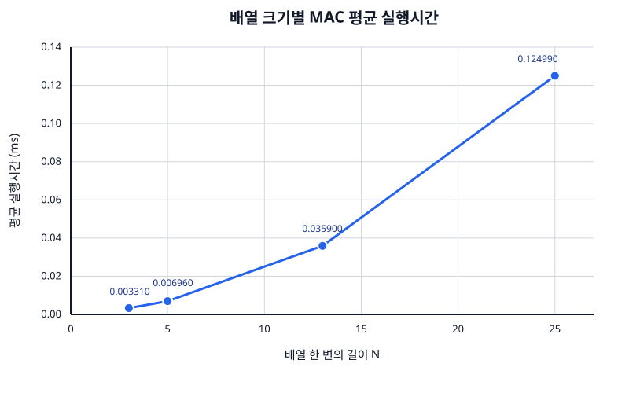

# Mission E3 — Mini NPU Simulator

> Windows + Visual Studio Code 환경에서 Python으로 구현한 2차원 배열 기반 MAC(Multiply–Accumulate) 연산 및 패턴 분석 시뮬레이터

## 1. 프로젝트 개요

본 프로젝트는 2차원 배열에 대한 **원소별 곱셈 및 누산(MAC)** 연산을 Python으로 직접 구현하고, 입력 배열과 필터의 점수를 비교하여 패턴을 판정하는 학습용 Mini NPU 시뮬레이터입니다. 사용자 입력 모드와 `data.json` 분석 모드를 제공하며, 입력 검증·예외 처리·성능 측정·자동 테스트를 수행합니다.

### 주요 기능

- 3×3 배열 A, B 및 필터 F를 사용자가 직접 입력
- MAC 연산을 이용한 점수 계산과 A/B 비교
- Cross 및 X 필터 기반 JSON 패턴 분석
- 점수 차이가 `epsilon` 이하인 경우 `UNDECIDED` 판정
- JSON 예상 판정과 실제 판정의 PASS/FAIL 집계
- 배열 크기 검증 및 파일·메뉴 입력 오류 처리
- 3×3, 5×5, 13×13, 25×25 배열의 연산 횟수와 실행시간 측정

## 2. 개발 및 실행 환경

| 구분 | 환경 |
|---|---|
| 운영체제 | Windows |
| 개발 도구 | Visual Studio Code (VS Code) |
| 언어 | Python 3 |
| 터미널 | PowerShell |
| 작업 경로(개발 예시) | `C:\Temp\E3_Mini_NPU` |
| 데이터 형식 | JSON |

본 프로젝트는 **WSL/Ubuntu 없이 Windows 환경에서 실행**합니다. 표준 라이브러리를 이용한 구현을 기준으로 하며, 별도의 패키지 설치가 필요한 경우 실제 `main.py`의 import 문을 확인해 추가해야 합니다.

## 3. 프로젝트 파일 구성

```text
E3_Mini_NPU/
├── main.py               # 메뉴, MAC 연산, JSON 분석, 성능 측정
├── data.json             # 필터와 패턴 데이터
├── test_dimension.py    # 배열·필터 크기 검증
├── test_mac.py           # MAC 정상/오류 입력 테스트
├── test_final.py         # 최종 자동 통합 테스트
└── README.md             # 프로젝트 설명서
```

개발 중 생성한 `data_backup.json`, `data_temp.json` 등 백업·임시 파일은 제출 대상에서 제외할 수 있습니다.

## 4. 실행 방법

1. VS Code에서 프로젝트 폴더를 엽니다.
2. **Terminal → New Terminal**을 선택하여 PowerShell을 실행합니다.
3. 다음 명령을 입력합니다.

```powershell
cd C:\Temp\E3_Mini_NPU
python --version
python main.py
```

실행 메뉴:

```text
=== Mini NPU Simulator ===

[모드 선택]
1. 사용자 입력 (3x3)
2. data.json 분석
0. 종료
선택:
```

- **1:** 배열 A, 배열 B, 필터 F를 3행씩 입력하고 MAC 점수와 최종 판정을 확인합니다.
- **2:** `data.json`을 읽어 패턴별 MAC 판정·예상값 비교·성능 분석을 실행합니다.
- **0:** 프로그램을 종료합니다.

메뉴에서 잘못된 값(`3`, `abc`, 빈 입력, `-1` 등)을 입력하면 오류를 안내하고 메뉴로 돌아옵니다.

### 사용자 입력 모드 예시

배열 A (X 패턴):

```text
1 0 1
0 1 0
1 0 1
```

배열 B (Cross 패턴):

```text
0 1 0
1 1 1
0 1 0
```

필터 F (Cross 패턴):

```text
0 1 0
1 1 1
0 1 0
```

실행 결과:

```text
=== MAC 연산 결과 ===
A 점수: 1
B 점수: 5
판정: B
```

## 5. MAC 연산 알고리즘

MAC(Multiply–Accumulate)은 배열과 필터의 같은 위치 원소를 곱한 후 결과를 모두 더하는 연산입니다.

수학적으로 N×N 배열 A와 필터 F에 대해 다음과 같이 정의합니다.

\[
\operatorname{MAC}(A,F)=\sum_{i=0}^{N-1}\sum_{j=0}^{N-1} A_{ij}F_{ij}
\]

핵심 구현 구조:

```python
def mac(matrix, filter_matrix):
    validate_mac_dimensions(matrix, filter_matrix)
    total = 0
    for i in range(len(matrix)):
        for j in range(len(matrix[i])):
            total += matrix[i][j] * filter_matrix[i][j]
    return total
```

이 함수는 입력 배열과 필터의 크기를 검증한 후 MAC을 수행합니다. 3×3 입력 배열과 5×5 필터처럼 크기가 불일치하면 `ValueError`를 발생시켜 연산을 차단합니다.

## 6. epsilon 판정 및 UNDECIDED

두 MAC 점수의 차이가 매우 작을 때 무리하게 한쪽을 선택하지 않도록 `epsilon` 임계값을 적용합니다.

- `|score_cross - score_x| <= epsilon`: `UNDECIDED`
- `score_cross > score_x`이고 차이가 임계값보다 큼: `Cross`
- `score_x > score_cross`이고 차이가 임계값보다 큼: `X`

두 모드의 **동점 판정 기준은 동일**합니다. 두 점수의 차이가 `EPSILON` 이하이면 `UNDECIDED`를 반환하고, 그 외에는 더 높은 점수의 라벨을 반환합니다. 다만 모드별 요구사항에 따라 결과 후처리가 다릅니다.

- **사용자 입력 모드:** A와 B 중 어느 점수가 더 높은지 보여 줍니다. 동점이면 `UNDECIDED`를 그대로 사용자에게 출력하며, 별도의 예상값 검증은 하지 않습니다.
- **JSON 분석 모드:** Cross와 X 중 실제 판정을 계산한 뒤 JSON의 예상 라벨과 비교합니다. 따라서 동점 결과는 예상 라벨도 `UNDECIDED`일 때만 `PASS`이고, 예상 라벨이 `Cross` 또는 `X`이면 `FAIL`입니다. 이 모드는 점수 비교뿐 아니라 데이터에 기록된 기대 결과의 일치 여부도 검증하기 때문입니다.

`epsilon`의 실제 설정값은 제출 시 `main.py`의 값을 기준으로 확인합니다. 이 판정 방식은 동점 또는 근소한 점수 차이를 보류하는 의도적인 규칙입니다.

컴퓨터는 일부 십진수를 이진 부동소수점으로 정확히 표현하지 못해 연산 중 아주 작은 오차가 생길 수 있습니다. `epsilon`은 이런 미세한 차이를 실질적인 점수 차이로 오판하지 않도록 허용하는 기준입니다.

## 7. data.json 분석 결과

`data.json`은 최상위에 `meta`, `filters`, `patterns`를 포함합니다. 분석 대상 패턴은 총 6개입니다.

### 라벨 정규화

`normalize_label()`은 예상 판정과 필터 이름의 대소문자·공백·별칭 차이를 한곳에서 표준 라벨로 변환합니다. 변환 규칙을 별도 함수로 분리해 여러 호출부가 같은 기준을 재사용하게 하므로, 규칙 수정이나 새 별칭 추가 시 중복된 로직을 찾아 고칠 필요가 없어 유지보수가 쉽고 확장 범위도 명확합니다.

### 새 라벨 추가 체크리스트

- [ ] 표준 라벨과 허용할 입력 별칭을 정하고 `normalize_label()`에 변환 규칙을 추가합니다.
- [ ] JSON 필터로 사용할 경우 `normalize_filter_keys()`의 표준 키 매핑과 `data.json`의 필터 이름·필터 행렬을 함께 갱신합니다. 별칭 중복 및 미지원 이름 처리도 확인합니다.
- [ ] `classify_json_pattern()`에서 새 라벨을 점수에 따라 판정하도록 확장하고, `EPSILON` 이내의 동점은 기존처럼 `UNDECIDED`로 유지합니다.
- [ ] 예상 라벨 비교, 결과·실패 요약 출력 및 관련 JSON 데이터가 새 표준 라벨을 일관되게 사용하도록 확인합니다.
- [ ] 테스트에 별칭 정규화, 새 라벨이 선택되는 경우, 동점 처리, 잘못된/중복 필터 키 사례를 추가하고 기존 통합 테스트도 실행합니다.

| 패턴 | 예상 판정 | 실제 판정 | 결과 |
|---|---|---|---|
| `size_5_1` | X | UNDECIDED | FAIL |
| `size_5_2` | Cross | Cross | PASS |
| `size_13_1` | X | X | PASS |
| `size_13_2` | Cross | UNDECIDED | FAIL |
| `size_25_1` | X | UNDECIDED | FAIL |
| `size_25_2` | Cross | Cross | PASS |

```text
=== 전체 테스트 결과 요약 ===
총 테스트: 6
PASS: 3
FAIL: 3
```

### 실패 원인 분석

`size_5_1`, `size_13_2`, `size_25_1`은 JSON에 지정된 예상값이 X 또는 Cross이지만, **원래 MAC 점수와 epsilon 판정 기준**을 적용하면 `UNDECIDED`가 나옵니다. 즉, 해당 3건은 예상 라벨과 실제 판정이 일치하지 않습니다.

이 결과를 감추거나 정답에 맞추기 위해 알고리즘을 임의 변경하지 않았습니다. 향후 개선 시에는 `epsilon` 값의 타당성, 패턴 데이터의 구분력, 필터 설계 및 기대 라벨의 적절성을 별도로 검토할 수 있습니다.

> **주의:** 위의 JSON 패턴 판정 3 PASS / 3 FAIL은 아래의 프로그램 기능 자동 통합 테스트 12 PASS / 0 FAIL과 서로 다른 검증 결과입니다.

## 8. 성능 측정 및 시간복잡도

Python의 `time.perf_counter()`를 이용하여 MAC 연산을 반복 측정하고 평균 실행시간을 계산했습니다. 아래 시간은 STEP 9-5-1에서 확인한 실행 예시이며, PC 상태와 실행 시점에 따라 변동됩니다.

| 배열 크기 | 평균 실행시간(ms) | 원소별 곱셈 횟수 |
|---|---:|---:|
| 3×3 | 0.003310 | 9 |
| 5×5 | 0.006960 | 25 |
| 13×13 | 0.035900 | 169 |
| 25×25 | 0.124990 | 625 |

측정값을 배열 한 변의 길이 `N`에 따라 나타내면 다음과 같습니다.



그래프의 x축은 배열 한 변의 길이 `N`에 비례합니다. 실행시간은 N이 커질수록 증가해 `N²` 연산량 분석과 같은 방향의 추세를 보입니다. 다만 검증 비용과 측정 환경의 영향이 포함된 네 개의 표본이므로, 그래프만으로 정확한 점근 복잡도를 증명하는 것은 아닙니다.

N×N 배열에 대해 모든 원소를 한 번씩 방문하므로 곱셈 횟수는 **N²**이며, 이중 반복문의 이론적 시간복잡도는 **O(N²)**입니다. 예를 들어 5×5에서 25×25로 커지면 한 변의 길이는 5배, 곱셈 횟수는 25배가 됩니다.

배열 크기별 성능표의 `measure_mac_time()`은 검증이 포함된 `mac()` 호출을 측정하므로, 그 시간에는 배열 검증 비용도 들어갑니다. 반면 사용자 입력 모드는 입출력과 크기 검증을 타이머 밖에서 수행하고 MAC 계산 루프만 측정합니다.

### CPU 직렬 계산과 NPU 병렬 처리의 병목

현재 구현은 Python의 중첩 반복문으로 원소를 하나씩 처리하는 **CPU 직렬 시뮬레이션**이며, 실제 NPU의 병렬 실행이나 가속 성능을 측정하지 않습니다. 이 구현에서는 반복문·인덱싱·배열 검증 같은 Python 실행 비용이 주요 병목이 될 수 있고, 누산도 순차적으로 수행됩니다.

실제 NPU에서는 원소별 곱셈을 병렬화할 수 있지만, 입력을 장치로 옮기는 비용과 메모리 대역폭, 병렬 결과를 합산하는 reduction, 작업 시작·동기화 비용이 병목이 될 수 있습니다. 특히 작은 배열은 병렬 처리의 설정 비용이 계산 이득보다 커질 수 있으므로, 이 프로젝트의 실행시간은 CPU 기준 동작 확인용으로만 해석해야 합니다.

## 9. 예외 처리 및 기능 검증

| 검증 영역 | 내용 |
|---|---|
| 메뉴 입력 | 잘못된 숫자·문자·빈 입력·음수 처리, 메뉴 재출력, 정상 종료 |
| 배열 입력 | 숫자 부족·초과, 문자·소수 입력 오류 처리 |
| JSON 파일 | 파일 없음, 문법 오류, 필수 키 누락 처리 |
| 배열/필터 | 정사각형 여부, 크기 일치 여부, 빈 배열 검사 |
| 회귀 테스트 | 기존 JSON 6개 패턴 결과 유지 |
| 성능 | 3×3, 5×5, 13×13, 25×25 실행시간 및 연산 횟수 출력 |

배열 크기 검증과 MAC 함수 테스트는 각각 5건 모두 통과했습니다.

## 10. 최종 자동 통합 테스트

다음 명령으로 최종 테스트를 실행합니다.

```powershell
python test_dimension.py
python test_mac.py
python test_final.py
```

`test_final.py`의 검증 결과:

```text
=== Mission E3 최종 통합 테스트 ===
[PASS] 3x3 MAC 연산
[PASS] 정상 배열 크기 검증
[PASS] 크기 불일치 오류 처리
[PASS] Cross 라벨 정규화
[PASS] X 라벨 정규화
[PASS] 필터 키 별칭 정규화
[PASS] 중복 필터 키 거부
[PASS] UNDECIDED 판정
[PASS] JSON 데이터 구조
[PASS] JSON 패턴 6개
[PASS] MAC 성능 측정
[PASS] 사용자 모드 측정에서 검증 제외

=== 최종 통합 테스트 결과 ===
총 테스트: 12
PASS: 12
FAIL: 0
최종 통합 테스트 성공
```

**최종 결과: 자동 통합 테스트 12/12 PASS.** 이 결과는 프로그램의 핵심 기능과 예외 처리 일부가 정상 동작함을 보여줍니다. 모든 가능한 입력을 검증했다는 뜻은 아닙니다.

## 11. 구현 성과 및 개선 방향

**구현 성과**

- Python으로 2차원 배열과 MAC 연산을 직접 구현
- 입력 배열·필터 크기 검증과 사용자 오류 처리 구현
- JSON 패턴 분석 및 예상 라벨 비교 자동화
- epsilon을 이용한 보류 판정(`UNDECIDED`) 구현
- 배열 크기에 따른 연산 횟수와 실행시간 측정
- 최종 자동 통합 테스트 12/12 PASS 달성

**향후 개선 방향**

- 반복 횟수를 늘려 성능 측정 편차 완화
- 배열 검증시간과 순수 MAC 계산시간 분리
- epsilon 값과 필터 설계의 영향 분석
- 테스트 케이스 확장 및 자동화

### 대규모 입력의 영향과 최적화 우선순위

패턴 수를 `P`, 배열 한 변의 길이를 `N`이라고 하면 패턴별 Cross/X MAC 계산 시간은 대략 `O(PN²)`입니다. 현재는 JSON 전체를 한 번에 메모리에 올리므로 입력 데이터의 메모리 사용량도 대략 `O(PN²)`로 커지며, Python 리스트와 숫자 객체의 실제 메모리 비용은 원시 숫자 데이터보다 큽니다. 따라서 패턴 수나 배열 크기가 커지면 처리 시간이 늘고, 메모리가 먼저 한계에 도달할 수도 있습니다.

개선은 다음 순서로 진행합니다.

1. **측정과 입력 한도:** 대표적인 크기에서 시간·최대 메모리를 측정하고, 허용할 배열 크기와 패턴 수를 검증해 과도한 입력을 조기에 거부합니다.
2. **메모리 절감:** 전체 JSON 로드가 병목이면 패턴을 순차 처리하는 스트리밍 방식을 검토하고, 불필요한 중복 배열 복사를 피합니다.
3. **계산 최적화:** 프로파일링으로 MAC 계산이 병목임을 확인한 뒤 NumPy 등 벡터화 적용을 검토합니다.
4. **병렬화:** 패턴 간 독립 계산을 병렬화할 수 있지만, 프로세스·작업 생성과 데이터 전달이 추가 시간 및 메모리를 쓰므로 앞 단계의 측정·최적화 이후에 적용합니다.

---

**Mission E3 — Mini NPU Simulator**  
실행 환경: Windows / VS Code / Python
